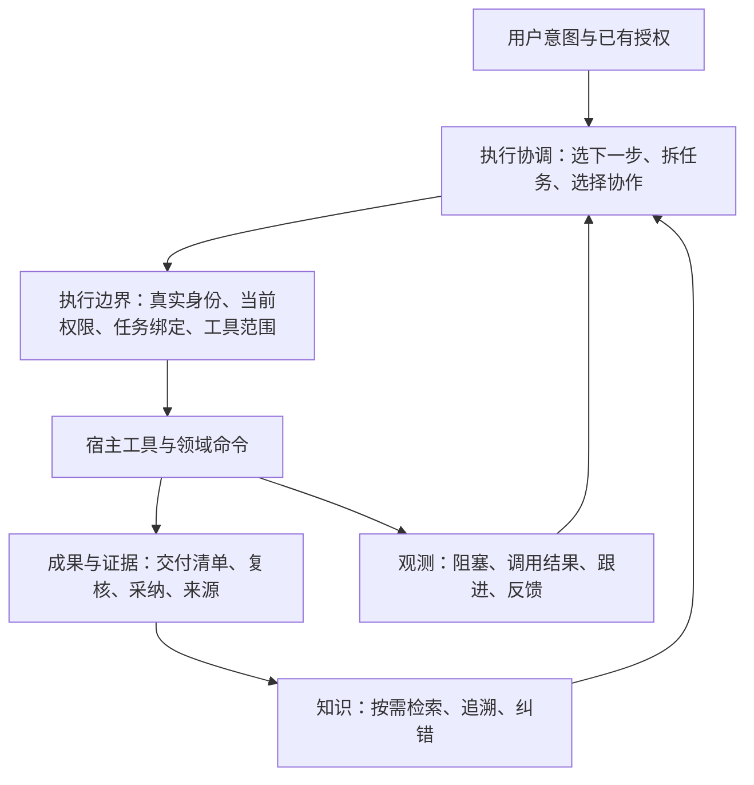

# mind 当前架构

更新：2026-10-20。本文解释当前开发架构、职责和缺口；具体运行结果以对应源码与验收记录为准。产品方向见[产品方向与效用验证](docs/design/产品方向与效用验证-2026-10-20.md)，后续工程顺序见[路线](docs/ROADMAP.md)。

## 1 产品主路径

mind 帮助用户推进工作，留下可验证、可复用、可纠错的成果。直接执行、委派、复核和会审是可选择的工作方式；组织规模、审计条数和记忆存量不代表产品收益。

| 工作 | 默认做法 | 需要的机制 |
|---|---|---|
| 普通问答、澄清、已授权的只读调查 | 直接回应或调查，不先建任务 | 原有访问权限和必要上下文 |
| 有明确交付、需委派或保留验收证据 | 建立可验收任务，选择本人执行或成员执行 | 真实绑定、冻结判据、工具范围、产物证据、复核与采纳 |
| 存在重要分歧，需要独立意见 | 按需开启会审 | 独立答案、盲评、来源、分歧与反例；结论不代替复核票 |
| 工作受阻 | 保留已发生事实，推进仍合法的独立工作 | 阻塞原因、恢复条件、跟进与反馈；不猜测操作未发生 |
| 有可复用成果 | 先保留来源，按适用条件检索；满足条件再晋升 | 召回与历史浏览分开、内容预算、引用、纠错 |

正式任务当前仍执行 v2 的复核、免审开关、打回升级及结账处置规则。将流程列为可改进策略，不表示本次已删除对应检查。

## 2 四个职责层

| 层 | 拥有什么 | 不承担什么 |
|---|---|---|
| 执行协调 | 对意图的理解、方案选择、任务拆分、优先级、协作方式 | 不自行授予权限，不把措辞判断当执行凭证 |
| 执行边界 | 身份与岗位凭证、项目身份、当前授权、工具与文件范围、并发写前检查 | 不决定最佳方案，不把所有工作强塞同一流程 |
| 成果与知识 | 任务事实、提交内容清单、复核票与采纳、记忆来源和状态 | 字段完整不代表知识为真，复核通过不代表用户目标自动完成 |
| 观测与反馈 | 调用和阻塞事实、恢复关联、原因声明、统计口径及采集健康 | 不修改权限、不自动批准、不改变任务状态、不代替实际成功回执 |

LLM 负责难以穷举的语义判断；机器检查可观测的身份、版本、范围、状态和一致性。提示词只指导如何使用机制，不能替代工具入口检查。

## 3 约束分层

| 类别 | 保护什么 | 当前执行方式 | 调整方式 |
|---|---|---|---|
| 授权与身份 | 不越授、不自授、不借他人身份操作 | 策略引擎、真实实例凭证、宿主工具 guard | 由现有授权入口变更，不能借反馈绕过 |
| 证据与事实 | 旧票不验新内容、未知不冒成功、不补签历史 | 内容清单、票据、严格任务读取、真实回执 | 改进协议及可验证实现，保留既有事实 |
| 工作流策略 | 何时协作、何时升级、如何处理知识候选 | Lead 判断及现行任务规则 | 用成本与质量证据调整；变更另留合同与测试 |
| 界面与交互 | 用户能看懂当前进度并作决定 | 服务端投影、看板及受控命令路由 | 可以提供按钮；按钮仍调用同一受控命令 |

“工作台是纯投影”要求状态可重建，不要求用户永远手敲命令。“成员绑定任务”只证明归属，不能自动变成任意文件或 shell 权限。

拒绝应定位到具体动作，并说明当前原因和恢复条件。可以继续的已授权工作不因另一个动作受阻而全部停止。规则修改后重新核验，不允许反复盲试或自动扩权。

## 4 实现边界与真源

| 职责 | 当前主要实现 | 事实来源 |
|---|---|---|
| 装配与共享运行时 | `src/org.js`、`src/runtime.js` | 私有区根与组织配置；共享同一装配实例 |
| 授权与身份 | `src/policy.js`、`src/registry.js`、`src/instance-snapshot.js` | 生效规则、身份档案、钉住的岗位与实例凭证 |
| 项目与文件边界 | `src/project-identity.js`、`src/tool-file-scope.js` | 规范真实目录、可信绑定、部署上限与冻结任务范围 |
| 任务与产物 | `src/tasks.js`、`src/task-ledger.js`、`src/artifact-manifest.js` | 任务事件、内容摘要、复核票及采纳事实 |
| 记忆与能力 | `src/memory.js`、`src/memory-response.js`、`src/retrieval.js`、`src/capability.js` | 记忆账本、来源引用、状态追加和能力版本；响应模块只处理预算与呈现 |
| 复核与会审 | `src/review.js`、`src/council.js` | 任务复核事件与独立会审事件，分别承担验收和咨询 |
| 审计与安全自检 | `src/audit.js`、`src/probes.js` | 审计链、实际 guard 回执、规则件与撤回记录 |
| 阻塞观测与反馈 | `src/observability.js`、`components/kernel/lib/observability-hooks.js` | 真实执行尝试与追加审计事实；模型原因声明与人侧确认分开 |
| 工具与界面适配 | `lib/actions.js`、`components/kernel/lib/`、`components/board/lib/` | 调用领域服务，不能另建权限或状态真源 |
| 委派计划与宿主执行 | `lib/member-spawn-plan.js`、`lib/host-execution.js` | 同一次准备的审批/执行计划；公开宿主接收、释放与中断回执，各自保持语义 |

领域服务拥有业务事实和规则；工具、命令及界面负责转换输入输出。新能力不应继续在巨大入口中复制判定。观测由追加事实生成读面，统计缓存也只能是可重建派生件。

治理对象按标签和当前规则判权限；文件工具还必须检查真实路径、链接、任务范围和私有区边界。两者共同生效，“只读标签”不是跳过文件边界的理由。

## 5 监控如何影响设计

安全探针回答“机制是否正常”，效用反馈回答“机制是否帮助推进”。两者分开显示。

阻塞必须保留规则、版本、主体、项目和操作归属。恢复需关联同一工作范围内的真实成功；审批通过、重试开始或其他工具成功均不能代替恢复事实。未决、放弃和采集缺口分别报告。

`monitor_query` 提供有界读面；`monitor_followup` 关联重试或放弃；`monitor_feedback` 只提交模型声明。看板的人侧反馈通过认证同源路由追加并独立回读，不在浏览器修改事实。权限预检得到拒绝属于诊断，不能记作实际执行阻塞或恢复。

原因反馈是可追溯声明。模型提出疑似误判，人侧确认单列；后来补了授权才成功不算原规则误判。反馈形成规则修订候选，再经案例和原有授权变更流程验证，不自动放宽限制。

先记录阻塞到恢复的经过时间、跟进结果和人工介入类型。没有可信数据时，费用、token、用户处理时间和误拦截率显示未知；不以“无记录”代替“零成本”。重复记录与未跟进样本不得静默丢弃。

## 6 连续工作能力与剩余缺口

持久目标已形成最小开发合同：记录来源转述、当前结果和约束、修订、任务关联及有证据的完成判断；新装配重建当前读面。机器限制覆盖关联任务的新推进和成员活动文件范围，具体边界见[目标与当前约束](docs/design/持久目标与当前约束-2026-10-20.md)。以下仍未完成：

- 可核验的对话用户意图来源、Lead 原生工具的真实目标归因及按需工作上下文装配；当前转述不冒认用户认证。
- 跨进程执行尝试、可靠接管、持久操作回执和部分提交的统一恢复；已补明确提交点回执、组织任务终止与正式后继，尚无宿主副作用自动对账与安全重放。
- 目标共享预算的并发预占、结算和未决用量对账。
- 用户限制变更向在途执行传播，以及可证明的安全停点。
- 知识适用条件、复验触发、采用结果与纠错的完整反馈。

这些能力不能靠新增状态名或提示词冒充完成。先取得宿主支持的执行、停止和计量事实，再设计协议；操作记录不成为第二套授权主体。具体判据见[场景推演](docs/design/端到端场景推演-2026-10-20.md)。

## 7 交付与验证

源码、离线测试、真实宿主验证和部署分别留证。新代码只在开发目录验证；运行链接目录的修改属于独立部署操作。

现有四项边界修复及限制见[第一批验收](docs/design/第一批边界修复验收-2026-10-20.md)。严格任务读取不能检测合法行删除或整本回滚；内容摘要和同步 guard 不能替代 OS 隔离。上述能力不因测试数量增加而获得更强保证。

本轮入口与流程、有界记忆、阻塞监控和反馈的最终源码指纹、完整测试及未验证边界见[重整验收](docs/重整验收-2026-10-20.md)，监控的具体事实与覆盖口径见[实现合同](docs/design/阻塞监控反馈闭环-2026-10-20.md)。

后续宿主接线、共享派发计划、部分提交回执与实例绑定收紧另见[第二轮验收](docs/第二轮修复验收-2026-10-20.md)，不沿用前一轮测试数字证明新代码。

明确终止、唯一正式后继、累计失败继承、只读幂等认回和精确依赖派发另见[第三轮验收](docs/第三轮修复验收-2026-10-20.md)。组织终止不证明宿主停止，后继关系不改变原下游依赖。

目标修订、任务关联、成员文件当前限制、逐依据完成判断与跨会话摘要另见[第四轮验收](docs/第四轮修复验收-2026-10-20.md)。任务全部采纳不自动完成目标，暂停不证明在途宿主操作已停止。
