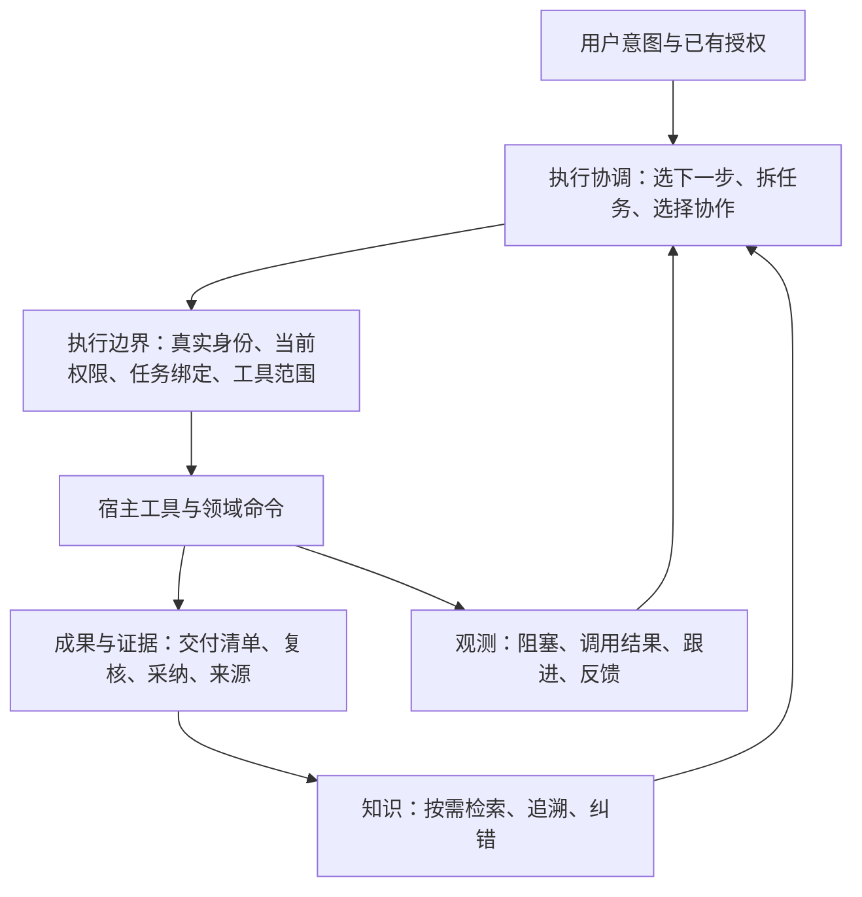

# mind 当前架构

更新：2026-10-22。本文解释当前主线架构、职责和缺口；源码同步及实机验收范围见[当前状态](docs/STATUS.md)，历史报告不代表当前运行状态。产品方向见[产品方向与效用验证](docs/design/产品方向与效用验证-2026-10-20.md)，Lead与专业分工的目标设计见[职责合同](docs/design/Lead与专业智能体-2026-10-22.md)，后续工程顺序见[路线](docs/ROADMAP.md)。

## 1 产品主路径

mind 帮助用户推进工作，留下可验证、可复用、可纠错的成果。直接执行、委派、复核和会审是可选择的工作方式；组织规模、审计条数和记忆存量不代表产品收益。

2026-10-22确认的产品主轴是：Lead长期面向用户，承担需求理解、人格与成长、专业分配和整体结果责任；专业智能体分别积累领域知识与方法，按需协作，减少无关内容进入一次思考。Lead的核心专业是理解人、定义问题和整合结果，精简其专业细节负担不等于削弱判断能力。

当前已有[专业岗位知识默认召回](docs/design/专业默认召回与上下文-2026-10-22.md)、[Lead连续性装配](docs/design/Lead连续性与更正-2026-10-22.md)及[需求理解与工作上下文](docs/design/需求理解与工作上下文-2026-10-22.md)，在原有系统装配事件中提供有界资料。专业知识按真实岗位选取；人格与偏好复用私有偏好账本；需求解释随目标事件修正，成员只取得当前绑定任务简报。主动提炼、语义理解与分配质量及成长效果闭环仍待验证。下文描述的身份、任务、记忆与治理机制继续承载实际边界。

| 工作 | 默认做法 | 需要的机制 |
|---|---|---|
| 普通问答、澄清、已授权的只读调查 | 直接回应或调查，不先建任务 | 原有访问权限和必要上下文 |
| 有明确交付、需委派或保留验收证据 | 建立可验收任务，选择本人执行或成员执行 | 真实绑定、冻结判据、工具范围、产物证据、复核与采纳 |
| 存在重要分歧，需要独立意见 | 按需开启会审 | 独立答案、盲评、来源、分歧与反例；结论不代替复核票 |
| 工作受阻 | 保留已发生事实，推进仍合法的独立工作 | 阻塞原因、恢复条件、跟进与反馈；不猜测操作未发生 |
| 有可复用成果 | 先保留来源，按适用条件检索；满足条件再晋升 | 召回与历史浏览分开、内容预算、引用、纠错 |

正式任务当前仍执行 v2 的复核、免审开关、打回升级及结账处置规则。将流程列为可改进策略，不表示本次已删除对应检查。

## 2 四个职责层

| 层 | 拥有什么 | 不承担什么 |
|---|---|---|
| 执行协调 | 对意图的理解、方案选择、任务拆分、优先级、协作方式 | 不自行授予权限，不把措辞判断当执行凭证 |
| 执行边界 | 身份与岗位凭证、项目身份、当前授权、工具与文件范围、并发写前检查 | 不决定最佳方案，不把所有工作强塞同一流程 |
| 成果与知识 | 任务事实、提交内容清单、复核票与采纳、记忆来源和状态 | 字段完整不代表知识为真，复核通过不代表用户目标自动完成 |
| 观测与反馈 | 调用和阻塞事实、恢复关联、原因声明、统计口径及采集健康 | 不修改权限、不自动批准、不改变任务状态、不代替实际成功回执 |

LLM 负责难以穷举的语义判断；机器检查可观测的身份、版本、范围、状态和一致性。提示词只指导如何使用机制，不能替代工具入口检查。

## 3 约束分层

| 类别 | 保护什么 | 当前执行方式 | 调整方式 |
|---|---|---|---|
| 授权与身份 | 不越授、不自授、不借他人身份操作 | 策略引擎、真实实例凭证、宿主工具 guard | 由现有授权入口变更，不能借反馈绕过 |
| 证据与事实 | 旧票不验新内容、未知不冒成功、不补签历史 | 内容清单、票据、严格任务读取、真实回执 | 改进协议及可验证实现，保留既有事实 |
| 工作流策略 | 何时协作、何时升级、如何处理知识候选 | Lead 判断及现行任务规则 | 用成本与质量证据调整；变更另留合同与测试 |
| 界面与交互 | 用户能看懂当前进度并作决定 | 服务端投影、看板及受控命令路由 | 可以提供按钮；按钮仍调用同一受控命令 |

“工作台是纯投影”要求状态可重建，不要求用户永远手敲命令。“成员绑定任务”只证明归属，不能自动变成任意文件或 shell 权限。

可信宿主真实根Agent首次登记自身Lead是有限机械出生，只免该笔confirm；身份锁内仍核撤权、当前卡及竞争登记，失联与硬拒继续生效。业务审批、旧运行绑定和封存恢复另按原合同，不借新会话出生恢复旧身份。详见[出生与审批边界](docs/design/真实根会话Lead出生与审批边界-2026-10-21.md)。

调度创建规则在首道范围闸激活前就已具备判定能力；专用创建闸未就绪或正在注销时由首闸承接，原有范围拒绝优先。两处共享同一策略和handler，只认本次内存注册事实，不以磁盘回执或晚到回调续用旧授权。详见[冷启动边界](docs/design/调度冷启动创建边界-2026-10-21.md)。

拒绝应定位到具体动作，并说明当前原因和恢复条件。可以继续的已授权工作不因另一个动作受阻而全部停止。规则修改后重新核验，不允许反复盲试或自动扩权。

## 4 实现边界与真源

| 职责 | 当前主要实现 | 事实来源 |
|---|---|---|
| 装配与共享运行时 | `src/org.js`、`src/runtime.js` | 私有区根与组织配置；共享同一装配实例 |
| 授权与身份 | `src/policy.js`、`src/registry.js`、`src/instance-snapshot.js` | 生效规则、身份档案、钉住的岗位与实例凭证 |
| 项目与文件边界 | `src/project-identity.js`、`src/tool-file-scope.js` | 规范真实目录、可信绑定、部署上限与冻结任务范围 |
| 任务与产物 | `src/tasks.js`、`src/task-ledger.js`、`src/artifact-manifest.js` | 任务事件、内容摘要、复核票及采纳事实 |
| 目标与受管准入额度 | `src/goals.js`、`src/goal-ledger.js`、`src/goal-budget.js`、`src/budget-ledger.js` | 目标当前修订及任务引用、独立额度配置与逐次预占/结果事实；额度不授予执行权 |
| 记忆与能力 | `src/memory.js`、`src/memory-response.js`、`src/retrieval.js`、`src/capability.js` | 记忆账本、来源引用、状态追加和能力版本；响应模块只处理预算与呈现 |
| 专业默认上下文 | `src/professional-context.js`、`components/kernel/lib/professional-context.js` | 当前真实岗位、卡、任务绑定、项目与复核读域；有界知识摘要每次替换装配，不缓存许可或改写记忆 |
| Lead连续性 | `src/lead-continuity.js`、`src/lead-context.js`、`components/kernel/lib/lead-context.js` | 私有偏好账本中的人格、用户偏好与教训；按声明范围自动装配，支持替代、停用及已引用来源撤回 |
| Lead会话目标与教训选择 | `src/lead-focus.js`、`src/goals.js`、`components/kernel/lib/accepted-expression.js`、工作与连续性装配 | 工作概览优先本会话目标；教训优先本轮已接纳且仍可见的用户来源文本，再用目标线索；只读选材不另存聊天或认证当前意图，公开记忆查询口径不变 |
| 协作反馈与后续案例 | `src/collaboration-feedback.js`、记忆与Lead连续性装配 | 教训复盘及后续结果声明共用私有账本；核对真实目标历史引用，保留失败和未知，有界计数不认证成长 |
| 需求理解与当前工作 | `src/demand-understanding.js`、`src/work-context.js`、`components/kernel/lib/work-context.js` | 需求解释随目标事件追加；Lead看未收尾目标及交付进展，成员只看当前绑定任务简报，沿用原整体证据核对 |
| 复核与会审 | `src/review.js`、`src/council.js` | 任务复核事件与独立会审事件，分别承担验收和咨询 |
| 审计与安全自检 | `src/audit.js`、`src/probes.js` | 审计链、实际 guard 回执、规则件与撤回记录 |
| 阻塞观测与反馈 | `src/observability.js`、`components/kernel/lib/observability-hooks.js` | 真实执行尝试与追加审计事实；模型原因声明与人侧确认分开 |
| 模型用量观察 | `src/model-usage.js`、`src/model-usage-ledger.js`、`src/model-usage-scope.js`、`components/kernel/lib/model-usage-hooks.js` | 已接入宿主 assistant-stream 的开始、最新 usage 与结束观察；不冒充模型调用前费用准入或全量计费 |
| 工具与界面适配 | `lib/actions.js`、`components/kernel/lib/`、`components/board/lib/` | 调用领域服务，不能另建权限或状态真源 |
| 委派计划与宿主执行 | `lib/member-spawn-plan.js`、`lib/host-execution.js` | 同一次准备的审批/执行计划；公开宿主接收、释放与中断回执，各自保持语义 |
| 成员创建恢复记录 | `src/spawn-operations.js`、`src/spawn-operation-ledger.js`、`lib/member-spawn-journal.js` | 创建前唯一意图、预留实例、阶段观察与问题中的确认凭据；不替代任务/身份/宿主真源或新增执行权限 |
| 知识采用反馈 | `src/knowledge-reuse-contract.js`、`src/knowledge-reuse.js`、`src/tasks.js`、`src/memory.js` | 可选声明随真实交卷入原任务事件；完整来源捕获和当前读域核对分开，不另存任务状态或自动改变知识有效性 |
| 知识适用与复验提示 | `src/knowledge-applicability.js`、`src/memory.js`、`src/memory-response.js` | 可选作者说明、显式期限及同次读取的召回资格；到期不追加失效状态，查询缓存与分页随资格边界更新 |

领域服务拥有业务事实和规则；工具、命令及界面负责转换输入输出。新能力不应继续在巨大入口中复制判定。观测由追加事实生成读面，统计缓存也只能是可重建派生件。

治理对象按标签和当前规则判权限；文件工具还必须检查真实路径、链接、任务范围和私有区边界。两者共同生效，“只读标签”不是跳过文件边界的理由。

## 5 监控如何影响设计

安全探针回答“机制是否正常”，效用反馈回答“机制是否帮助推进”。两者分开显示。

阻塞必须保留规则、版本、主体、项目和操作归属。恢复需关联同一工作范围内的真实成功；审批通过、重试开始或其他工具成功均不能代替恢复事实。未决、放弃和采集缺口分别报告。

`monitor_query` 提供有界读面；`monitor_followup` 关联重试或放弃；`monitor_feedback` 只提交模型声明。看板的人侧反馈通过认证同源路由追加并独立回读，不在浏览器修改事实。权限预检得到拒绝属于诊断，不能记作实际执行阻塞或恢复。

原因反馈是可追溯声明。模型提出疑似误判，人侧确认单列；后来补了授权才成功不算原规则误判。反馈形成规则修订候选，再经案例和原有授权变更流程验证，不自动放宽限制。

先记录阻塞到恢复的经过时间、跟进结果和人工介入类型。模型用量另保留宿主已报告的最新快照与来源分母，失败和放弃尝试也保留已知用量。未覆盖历史、无 usage、未结束和未归因分别报告；全目标 token、费用、用户处理时间和误拦截率没有完整可信数据时显示未知，不以“无记录”代替“零成本”。重复记录与未跟进样本不得静默丢弃。

## 6 连续工作能力与剩余缺口

持久目标已形成最小开发合同：记录来源转述、当前结果和约束、修订、任务关联及有证据的完成判断；新装配重建当前读面。机器限制覆盖关联任务的新推进和成员活动文件范围，具体边界见[目标与当前约束](docs/design/持久目标与当前约束-2026-10-20.md)。人侧还可为目标配置受管准入尝试上限；普通成员的可归因文件调用与 `member_spawn` 在同一账本并发预占，失败或未知不返还。该部分合同见[受管额度](docs/design/目标共享准入额度-2026-10-20.md)。以下仍未完成：

- 可核验的对话用户意图来源及Lead原生工具的真实目标归因；有界工作资料已有装配，本会话目标线索不等于当前聊天焦点，当前转述不冒认用户认证。
- 全部宏动作的持久操作回执与统一恢复、可靠执行接管；成员创建已有重建可读意图、阶段和确认凭据，同任务不再签发创建。尚无宿主副作用自动对账、安全重放或跨系统恰好一次。
- Lead 原生调用、会审等入口的可靠目标归因，以及全部模型调用与辅助调用的完整 token 和费用计量；当前只读模型观察仅提供已接入窗口、可证明归因的部分读数，现有准入额度不构成目标总成本上限。未知结果的自动对账仍未实现。
- 用户限制变更向在途执行传播，以及可证明的安全停点。
- 知识适用条件、复验触发、采用结果与纠错的完整反馈。
- 专业默认召回、Lead连续性及可修正需求解释与当前工作装配已有纵向实现；已补[本会话目标优先](docs/design/Lead会话目标与相关教训-2026-10-22.md)与[同轮已接纳表达的教训词面选材](docs/design/已接纳表达与教训选材-2026-10-22.md)。首步新输入直接选材、可信原话与语义焦点、持久专业索引、主动提炼、模型理解和分配质量的真实验证，以及反馈对后续行为改善的实际证据仍待补齐；设计见[Lead与专业智能体](docs/design/Lead与专业智能体-2026-10-22.md)。

这些能力不能靠新增状态名或提示词冒充完成。先取得宿主支持的执行、停止和计量事实，再设计协议；操作记录不成为第二套授权主体。具体判据见[场景推演](docs/design/端到端场景推演-2026-10-20.md)。

## 7 交付与验证

源码、离线测试、真实宿主验证和部署分别留证。新代码只在开发目录验证；运行链接目录的修改属于独立部署操作。

现有四项边界修复及限制见[第一批验收](docs/归档/验收记录/第一批边界修复验收-2026-10-20.md)。严格任务读取不能检测合法行删除或整本回滚；内容摘要和同步 guard 不能替代 OS 隔离。上述能力不因测试数量增加而获得更强保证。

本轮入口与流程、有界记忆、阻塞监控和反馈的最终源码指纹、完整测试及未验证边界见[重整验收](docs/归档/验收记录/重整验收-2026-10-20.md)，监控的具体事实与覆盖口径见[实现合同](docs/design/阻塞监控反馈闭环-2026-10-20.md)。

后续宿主接线、共享派发计划、部分提交回执与实例绑定收紧另见[第二轮验收](docs/归档/验收记录/第二轮修复验收-2026-10-20.md)，不沿用前一轮测试数字证明新代码。

明确终止、唯一正式后继、累计失败继承、只读幂等认回和精确依赖派发另见[第三轮验收](docs/归档/验收记录/第三轮修复验收-2026-10-20.md)。组织终止不证明宿主停止，后继关系不改变原下游依赖。

目标修订、任务关联、成员文件当前限制、逐依据完成判断与跨会话摘要另见[第四轮验收](docs/归档/验收记录/第四轮修复验收-2026-10-20.md)。任务全部采纳不自动完成目标，暂停不证明在途宿主操作已停止。

同目标的受管准入额度、异步 pre 预占与同步凭据闸，以及观测 pre 的 next 透传修复见[第五轮验收](docs/归档/验收记录/第五轮修复验收-2026-10-20.md)。静态 SDK 核查与隔离管线测试不替代真实宿主装载验收。

模型真实帧观察、按生命周期识别尝试与部分用量摘要见[第六轮验收](docs/归档/验收记录/第六轮修复验收-2026-10-21.md)。配置 `观测模型用量=false` 关闭采集，不改变工具权限和准入额度；观察写入失败也不拦截业务。

成员创建的持久意图、预留子会话身份、阶段观察和部分提交问题回执见[第七轮验收](docs/归档/验收记录/第七轮修复验收-2026-10-21.md)。初始追加未获确认不能调用宿主；后续记账失败不倒退已发生业务。普通文件追加和本地锁不构成掉电持久性或跨系统原子执行保证。

知识采用声明与历史交卷精确关联见[第八轮验收](docs/归档/验收记录/第八轮修复验收-2026-10-21.md)。省略、显式空与有声明分列；来源观察失败不阻止合法交卷。原任务事件保留完整声明，普通节点回执不带采用封套；治理只读投影按当前任务读权和记忆有效视图重建，来源不可核时不继续回传旧哈希。声明、来源版本与采纳事实分别可核，仍不证明知识语义正确或节省了成本。

作者声明的适用条件和复验期限见[第九轮验收](docs/归档/验收记录/第九轮修复验收-2026-10-21.md)。期限到点只改变默认建议资格，显式读取仍过原读域；合法交卷不因来源待复验停止。旧知识无说明时不补造期限或改变原捕获哈希。新字段进入披露、幂等、响应预算与整条删除边界，不另建验证状态机或自动续期。

负反馈到记忆处置的明确关联见[第十轮验收](docs/归档/验收记录/第十轮修复验收-2026-10-21.md)。`src/knowledge-feedback.js` 共用原交卷引用与小回执合同；记忆服务在原生命周期写入中核当前治理身份、读写权限和同份见证，私有状态只留指纹，公共fold剥除。治理投影从原交卷和真实处置重建关联，不新建账本或处理状态机；失效/待复验来源仍可核历史处置，缺失或不可读保持未知。关联只证明观察到明确引用的动作，实际复验、纠错成功和收益归因仍需独立证据。

治理知识读面在单次请求内共用读取快照，结束时复核来源范围、字节和当前读资格；来源变化使整组观察未知，任务变化或失去治理/任务读权则拒绝旧声明。它不跨请求缓存身份或提供可复用授权令牌，也不是跨账本原子事务。实现与规模反例见[第十一轮验收](docs/归档/验收记录/第十一轮修复验收-2026-10-21.md)。
