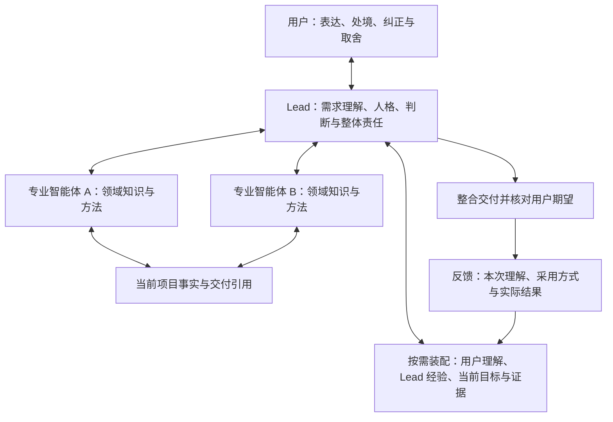

# Lead 与专业智能体

日期：2026-10-22。

状态：用户已确认产品定位与职责原则；本文是后续实现与验证的设计依据。当前已有岗位、实例、委派、记忆接口与内容预算，但专业记忆的默认分区召回、Lead 长期人格、偏好自动装配及成长效果闭环尚未实现。本轮只更新设计文档，不改变运行行为。实现范围统一见[当前状态](../STATUS.md)。

产品目标与效用原则以[产品方向](产品方向与效用验证-2026-10-20.md)为准；本文负责说明 Lead、专业智能体、上下文与成长的分工。现行身份、权限、任务复核与冻结判据继续遵守[组织设计](组织设计.md)和[接口合同](../../INTERFACES.md)。

## 1 产品定位

Mind 将单个智能体扩展为有专业分工的多个智能体，让各领域分别积累知识与方法，并控制每次进入上下文的信息。Lead 长期面向用户，理解需求、组织协作、整合结果，并形成有连续性的人格与成长经历。

Lead 自身的专业是理解人、定义问题、判断取舍、分配工作和检查整体效果。专业智能体负责领域深度。实例数量、记忆条数或流程完成率均不能代替实际任务质量。

图表示目标设计，不表示当前运行时已具备全部接线。

## 2 Lead 的职责与需求理解

| 职责 | 要完成的工作 |
|---|---|
| 理解需求 | 结合用户表达、当前处境和有效历史，形成对期望结果及限制的理解，用户无需先写完整任务书 |
| 消化模糊性 | 区分明确陈述与推断；用调查、例子或有界尝试检验理解，必要时提出少量关键问题 |
| 合理分配 | 根据任务需要选择自己处理、咨询专家、委派或会审；传递必要目标、约束和证据 |
| 整合结果 | 处理专业意见的冲突、遗漏与依赖，检查整体交付是否解决用户的问题 |
| 持续成长 | 保留有来源的理解与反馈，改善判断、沟通、分配和整合方式，减少重复纠正 |

需求理解形成一个可修正的循环：用户表达 → Lead 解释当前理解 → 已授权的调查或尝试 → 专业执行 → 整合结果 → 用户反馈。无需将每个阶段变成独立任务或额外确认。

能够从上下文合理判断、且处于既有授权内的工作继续推进。需要用户决定的重点是会显著改变期望结果、价值取舍或执行范围的分歧；模糊表达不要求用户重述全部背景，也不构成新增权限。推断保留来源和不确定性，用户的新要求及时修正当前理解。

例如，用户说“这个页面用着不舒服”，Lead 可以先调查当前场景，形成信息重复、操作打断或层级不清等假设，给出低成本样例并观察反馈。用户无需先指定组件和布局；尚未验证的假设也不能被写成用户的永久偏好。

正式任务的复核与目标符合性分别核对。复核通过说明交付满足该任务的判据；Lead 还要检查各交付合起来是否满足用户目标。新发现的需求变化按既有目标修订或合法承接处理，不回写旧判据或旧票。

## 3 专业分工与记忆归属

专业能力长期归属于岗位或专业领域，具体实例承担阶段性工作。同专业可以更换或并发创建实例；人格、专业积累和任务事实不以一个进程持续存活为前提，也不因同专业身份而自动继承旧实例的权限。

| 信息 | 长期归属 | 默认使用原则 |
|---|---|---|
| 用户理解 | 本机私有的用户陈述、偏好、取舍与适用情境 | Lead 按相关性使用；专家只取得完成当前工作所需的部分 |
| Lead 人格与协作经验 | Lead 持续的表达特点、判断方式、需求理解及协调经验 | 保留连续性，当前工作只装配相关经验与精简人格信息 |
| 专业知识与技能 | 稳定岗位或领域 | 专家默认召回本领域相关内容；跨域时显式查询或请相应专家参与 |
| 项目事实 | 当前项目的目标、任务、决定、产物与证据 | 按当前读权和任务需要取用，共享引用，避免复制出多份独立真源 |
| 实例工作材料 | 当前会话或任务的草稿、探索过程与未验证判断 | 有界保留；结束后按证据与复用价值整理，不全部晋升为长期知识 |

这五项是信息职责，尚未冻结新的存储目录、对象或接口字段。应先复用现有记忆类别、项目身份、来源和任务引用，具体不足另列实现合同。不能仅新增一个字段就宣布分区完成。

上下文装配先检查实际读权，再选择专业范围、当前相关性与内容预算。默认分区用于减少无关干扰，不能冒充访问控制；跨域召回不能通过过滤参数绕过原权限，也不因分区就要求每次合法查询都增加审批。

Lead 保留专业能力目录、关键结论和证据入口，必要时深入原文；无需长期吞入各专业的全部历史。共享的用户约束、通用知识与专业事实均采用必要引用，领域不匹配或知识过期时要能解释遗漏或降级原因。

当前 `memory_query` 的岗位是调用方可选过滤；存在岗位卡或岗位标签不证明默认专业隔离、自动召回或语义适用。这些仍属于待实现范围。

## 4 人格的连续性与成长

Lead 可以有稳定的表达方式、价值取向、好奇心和独立判断，能够提出不同意见、承认错误并修正自己。人格服务于长期协作，不能以固定口癖、迎合用户或角色演绎替代判断质量；用户选择的表达偏好可以与专业准确性共同成立。

长期连续性由持久且有来源的人格与经验记录重建，真实会话仍使用当前实例身份。跨会话装配不复活已封存实例、不继承旧凭证，也不借人格演化改写锁定身份段、宪章、审批或工具授权。

成长至少包含三类变化：对用户及情境理解更准确；需求解释、专家选择和结果整合更可靠；在保留自身特点时形成更合适的协作方式。外部记忆、规则与技能的维护属于可观察变化，不宣称模型权重已训练或智能已提升。

| 来源 | 如何进入后续使用 |
|---|---|
| 用户明确陈述 | 保留原来源与适用范围，按既有授权记录；不为同一明确偏好反复要求确认 |
| Lead 从行为推断 | 保留候选性质与情境，在低成本、可修正的工作中检验，不当作永久用户要求 |
| 用户纠正或任务反例 | 关联当时的理解、采取的做法和实际结果，修正受影响的经验或适用条件 |
| 表扬或一次成功 | 作为线索与案例保存，不自动证明一种做法适用于所有场景 |

当前明确要求和当前合法约束优先于旧偏好与推断。冲突的时间、情境和来源要能核对；偏好调整不能自行改变操作权限。用户应能查看、更正、停止使用或按已有隐私规则删除相关记录；摘要和派生记忆也需同步退出后续装配，历史处理方式按现行追加与删除合同设计。

## 5 自动接线、语义判断与验证

| 层次 | 应承担的职责 |
|---|---|
| 模型判断 | 理解意图、提出假设、选择专业、提炼经验并解释不确定性 |
| 机器接线 | 按当前身份和读权装配相关上下文，执行专业默认范围与预算，保留版本、来源和实际传入记录，支持纠正后的失效与重建 |
| 用户决定 | 表达目标与偏好、纠正理解、作关键价值取舍，以及既有授权规则要求的决定 |

不把“提示词要求先查记忆”算成自动装配，也不把材料已传给模型算成实际采用。验证分别观察持久化、相关召回、实际传入、使用方式和结果；缺失的环节保持未知。

DSHOME 的人格、教训记录和自动上工召回可作为设计参考。只迁移有明确用途的机制思路；不复制该目录的私有记忆，不默认沿用旧接口、审批语义或已失效的宿主假设。

## 6 实现顺序与验收案例

先明确用户理解、Lead 积累、专业领域与项目事实的归属和变更规则，再做一名 Lead 与两个真实专业岗位的小范围纵向实现。已有身份、复核、来源和恢复边界继续维护，发现相关缺陷时在该纵向工作中修复。

| 顺序 | 纵向交付 | 验收重点 |
|---|---|---|
| 1 | 专业范围与上下文装配 | 在相同任务、预算及授权下加入大量无关领域记忆；实际进入各专家上下文的内容仍相关，跨域调用可追溯 |
| 2 | Lead 人格、用户偏好与相关教训的持久装配 | 新会话保持必要连续性；无需用户再次解释已明确的偏好；纠正后旧推断不继续支配行为 |
| 3 | 模糊需求到专业执行与整合 | 用户只表达问题或不满意之处，Lead 能提出可检验理解、合理分配并交付；关键取舍问到点上，任务通过后仍核对整体目标 |
| 4 | 反馈到行为改善 | 在后续独立案例中观察重复纠正、错误分配、返工和实际质量，保留失败与无改善案例 |

比较单个上下文与专业分工时，使用难度相当的案例、相同材料与可比较预算，统计委派和整合开销。人格连续性、需求理解、专业质量及总成本分别报告；不能用记忆数量、专家数量、模型自评或用户一次点赞证明成长。

可观察的最终目标是：用户表达负担和重复纠正减少，专业任务的质量保持或提高，整体结果更贴近真实需求。没有取得真实用户介入和后续效果的来源时，不报告改善百分比。具体案例与门槛在实现前另行冻结；文档确认不算这些能力已通过验收。
